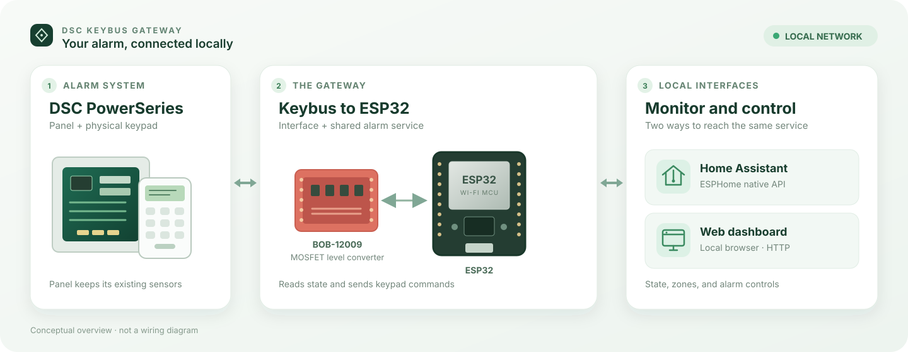
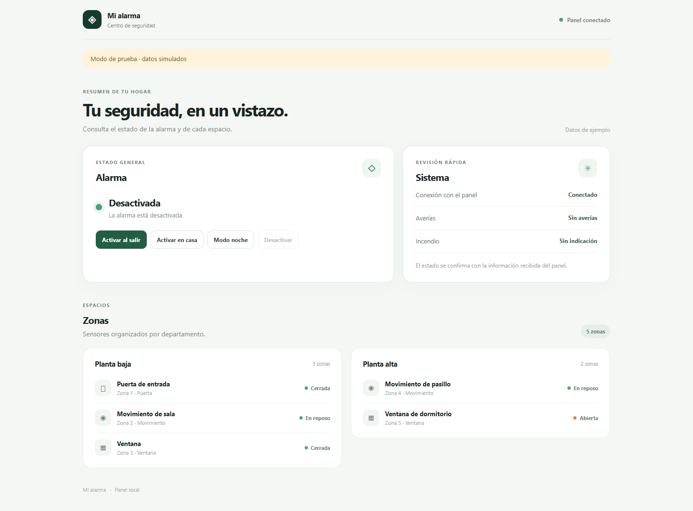
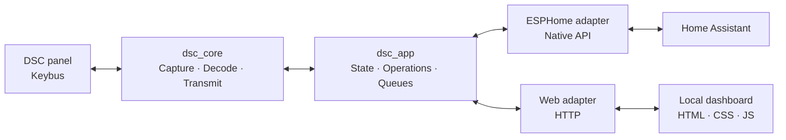

# DSC Keybus Gateway

**A local bridge between DSC PowerSeries panels, ESP32, and Home Assistant.**


The gateway reads panel status and coordinates keypad commands through a shared
service. It exposes a local dashboard and ESPHome entities while keeping Keybus
protocol handling independent of both interfaces.

> [!WARNING]
> **Prototype:** zone reads and arm/disarm cycles have been tested on one PC1864
> installation, as well as in simulation and on an isolated ESP32. This is not
> proof of compatibility with every installation or long-term reliability. The
> web interface uses unencrypted HTTP; see [Security](#security) before using it.



*Conceptual overview; this is not a wiring diagram.*

### Dashboard



*The dashboard shown above uses synthetic data. The current interface is in Spanish.*

## Features

- Observe partition state and up to 64 zones, preserving unknown states until the
  panel supplies enough information.
- Arm stay, away, or no-entry-delay (night), and disarm. An operation reports
  success when the requested panel state is observed, not just when keys are sent.
- Expose ESPHome's native API to Home Assistant and serve a lightweight dashboard
  with zones grouped by configured location.
- Exercise the real decoder and service against synthetic frames, an isolated
  ESP32, and automated host and target builds.

The initial hardware target is **PC1864 with ESP32**. Reference sources include
other models, but compatibility beyond the tested installation is not claimed.
Available arm modes and panel behavior also depend on panel programming.

## Architecture



The core owns Keybus mechanics. The application service serializes operations
from both adapters and distinguishes transmission from observed panel state. Zone
names and groups come from firmware configuration; they are not DSC partitions.
See [architecture](docs/architecture.md) for the data flow and queue boundaries.

## Get started without a panel

Host tests use synthetic frames and **do not access hardware**. On Windows with
Python 3.12:

```powershell
py -m venv .venv
.\.venv\Scripts\python.exe -m pip install -r requirements/dev.txt
.\.venv\Scripts\python.exe tools/run_tests.py
.\.venv\Scripts\python.exe tools/run_tests.py --own-core
.\.venv\Scripts\python.exe tools/run_tests.py --application
```

These runs test the upstream reference, our core, and the shared service with a
simulated panel. For Linux, CMake, ESP32 compilation, and dashboard checks, see
[development and testing](docs/development.md).

For a physically disconnected ESP32, the [bench guide](docs/bench.md) covers
explicit device identification, configuration, compilation, and opt-in tests.
See [zone configuration](docs/zones.md) for generic defaults and local labels.
[`firmware/physical-example.yaml`](firmware/physical-example.yaml) is an example:
its pins and zones must be reviewed for the actual installation. Bench simulation
cannot validate electrical levels or timing on a real Keybus.

## Security

ESPHome's native API uses encryption. The dashboard uses HTTP Digest authentication,
but **does not encrypt the connection**: alarm codes in command bodies can be
exposed on the network, and Digest does not fully prevent replay. A secure transport
and further validation are needed before permanent use. Do not expose the dashboard
directly to the Internet.

Software cannot lock a physical keypad during a sequence. An interruption or lost
connection can leave the result uncertain. Keep passwords, alarm codes, credentials,
and sensitive logs out of Git and examples.

## Repository map

| Path | Responsibility |
| --- | --- |
| [`lib/dsc_core/`](lib/dsc_core/) | Keybus capture, decoding, transmission, and observed state |
| [`lib/dsc_app/`](lib/dsc_app/) | Shared service, operations, scheduling, and zone catalog |
| [`components/`](components/) | ESPHome/Home Assistant and HTTP adapters |
| [`web/`](web/) | Dashboard sources embedded in the firmware |
| [`firmware/`](firmware/) | Example configurations and simulator |
| [`tests/`](tests/) | Test suites, fixtures, and the unmodified upstream reference |
| [`tools/`](tools/) | Build, validation, and opt-in bench tools |

## Documentation

- [Architecture](docs/architecture.md) — layers, observed state, and queues.
- [Development and testing](docs/development.md) — commands and checks.
- [Isolated bench](docs/bench.md) — opt-in ESP32 setup and validation.
- [OTA updates](docs/ota.md) — upload flow, credentials, and recovery limits.
- [Hardware reference](docs/hardware.md) — board details and recorded wiring.
- [Physical validation](docs/physical-validation.md) — what was tested and its limits.
- [Source and behavior ledger](docs/ports.md) — origins and implementation decisions.
- [Historical research and evidence](docs/history/) — first-milestone records.

## Credits and license

This project derives its Keybus foundation from
[taligentx/dscKeybusInterface](https://github.com/taligentx/dscKeybusInterface).
We also studied [Dilbert66's ESPHome components](https://github.com/Dilbert66/esphome-components)
and [DSC Keybus integration](https://github.com/Dilbert66/esphome-dsckeybus),
incorporating selected ideas and adaptations, including shared-pin behavior
and nonblocking command handling. Our queue is an independent implementation, not
a claim of a verbatim port. See the [source and behavior ledger](docs/ports.md)
for the exact decisions and evidence.

GPL-3.0-or-later. See [LICENSE](LICENSE), the original notices in
[`tests/reference-taligentx/`](tests/reference-taligentx/), and its pinned revision
and hashes in [`tests/reference-taligentx.lock.json`](tests/reference-taligentx.lock.json).
