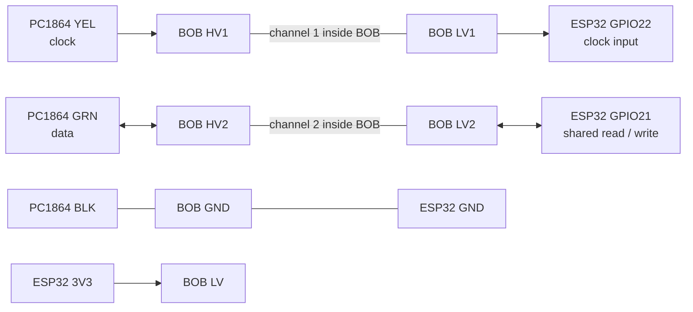

# Hardware and wiring reference

This page records the hardware and connections described for one PC1864
installation. It is **not a universal wiring diagram** or proof that every
DevKitC-compatible board or level converter is electrically suitable. Verify the
markings and circuit on the actual hardware before using these notes.

## Board and parts

- **Alarm panel:** DSC PowerSeries PC1864.
- **Development board:** a HiLetgo 38-pin ESP32-DevKitC/ESP32-32U, identified
  from the purchase listing. The photographed board has an external antenna
  connector; the exact revision and full pinout have not been independently
  verified. Use the labels on the board and check its 3.3 V supply with a meter.
- **Keybus interface:** SparkFun BOB-12009 bidirectional MOSFET level converter.
- **Optional supply:** a DC-DC buck converter with a 5 V USB output. A separate
  USB wall adapter is another option; the supply currently in use is not established
  by the test record.
- **Breakout:** a 38-pin screw-terminal adapter is optional. Verify that every
  label corresponds to the development board before relying on it.

The [Espressif DevKitC V4 guide](https://docs.espressif.com/projects/esp-dev-kits/en/latest/esp32/esp32-devkitc/user_guide.html)
provides a complete reference pinout for its documented board revision. The
HiLetgo board is a compatible product, not necessarily an identical Espressif
revision; check its silkscreen and actual connections. A 32U module requires a
compatible external antenna.

## Signal connections recorded in the earlier installation notes

The table below records the BOB-12009 variant described in the earlier local
installation guide. The tested firmware uses GPIO22 for clock and GPIO21 as the
shared read/write data pin. User-directed tests on one installation observed zone
changes and completed arm/disarm cycles, but they did not independently verify
every wire, voltage, waveform, or long-term electrical behavior.

| PC1864 terminal | BOB-12009 | ESP32 | Role |
| --- | --- | --- | --- |
| `YEL` | `HV1` ↔ `LV1` | GPIO22 | Clock, read only |
| `GRN` | `HV2` ↔ `LV2` | GPIO21 | Shared data, read/write |
| `BLK` | Either `GND` pad | GND | Common signal ground |
| — | `LV` | 3V3 | Low-side voltage reference |

Each channel's paired signal pads are linked through the converter's internal
MOSFET circuit; **do not add a jumper across a pair**. The diagram is a logical
connection map, not a drawing of the board's physical pin positions:

**This is a project-specific Keybus configuration**, not SparkFun's standard
level-converter hookup. See [SparkFun's hookup guide](https://learn.sparkfun.com/tutorials/bi-directional-logic-level-converter-hookup-guide)
for the board and [Dilbert66's wiring notes](https://github.com/Dilbert66/esphome-dsckeybus#mosfet-level-converter-version---recommended)
for the Keybus variant. Component placement and pull-ups can differ on lookalike
boards; do not assume an unidentified converter behaves the same way. Check the
configuration against the particular panel, converter and supply.

Do not connect `YEL` or `GRN` directly to an ESP32 GPIO. Do not connect panel
`RED`/`AUX+` directly to an ESP32 power pin or the converter's `LV` pad. Do not
insert relay modules into the Keybus lines.

## Power and common ground

The ESP32 can be powered through its USB port by a suitable 5 V supply. With the
non-isolated signal interface described above, the panel `BLK` and the ESP32/BOB
grounds still need a common reference, even with a separate wall adapter.

A panel-powered DC-DC buck is an alternative recorded in the earlier guide: its
input comes from the panel's DC auxiliary supply and its regulated 5 V output
powers the ESP32 over USB. Before using that option, verify polarity, the buck's
output, protection and the panel's remaining auxiliary-current budget for the
specific installation. Do not use the panel's AC terminals as a DC supply.

## Configuration and checks

The corresponding example in [`firmware/physical-example.yaml`](../firmware/physical-example.yaml)
uses `clock_pin: 22`, `read_pin: 21` and `write_pin: 21`. Omitting `write_pin`
disables Keybus transmission in this implementation. Read-only firmware does
not eliminate electrical loading or wiring faults. GPIO numbers are logical
identifiers, not positions on an arbitrary breakout board.

Before changing panel wiring, disarm and fully remove both AC supply and battery
power. If the transformer supply cannot be safely isolated, use a qualified alarm
technician. Inspect polarity, continuity, common ground and supply voltage before
powering the system again; verify that the physical keypad continues to respond.
The separate [bench guide](bench.md) covers tests on an ESP32 disconnected from
an alarm. See [physical validation](physical-validation.md) for the limited tests
actually performed on the recorded installation.
